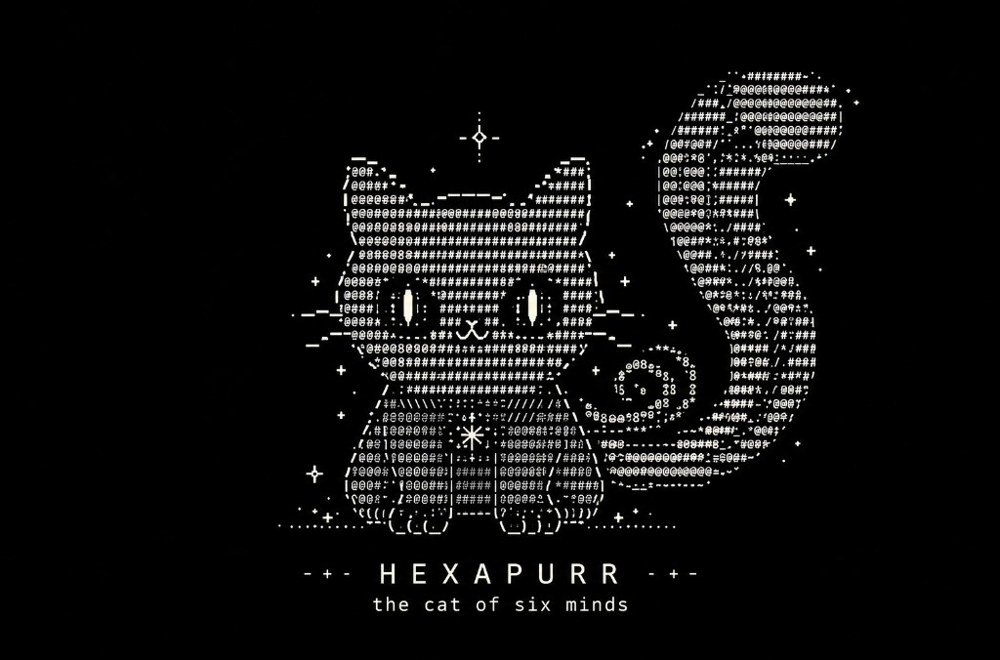
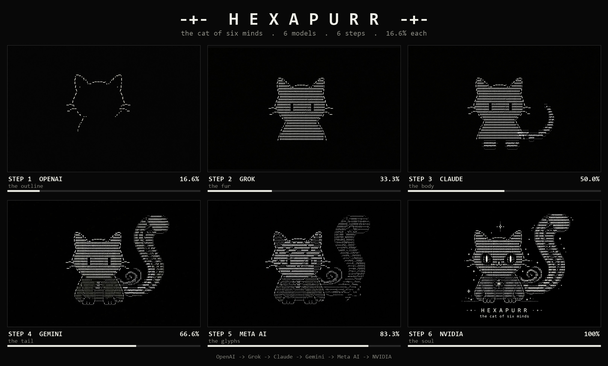
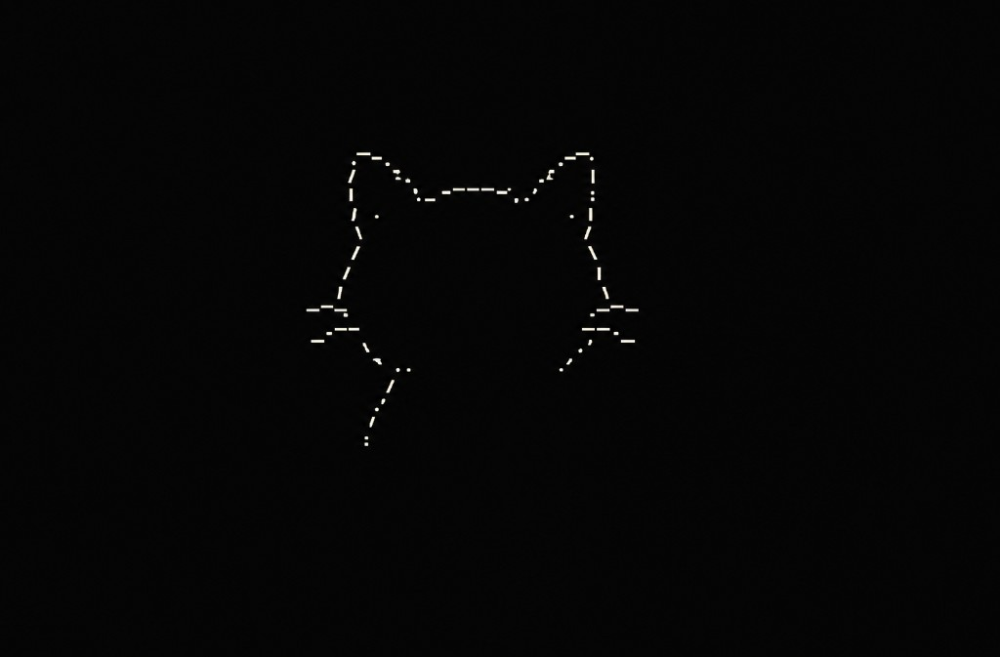
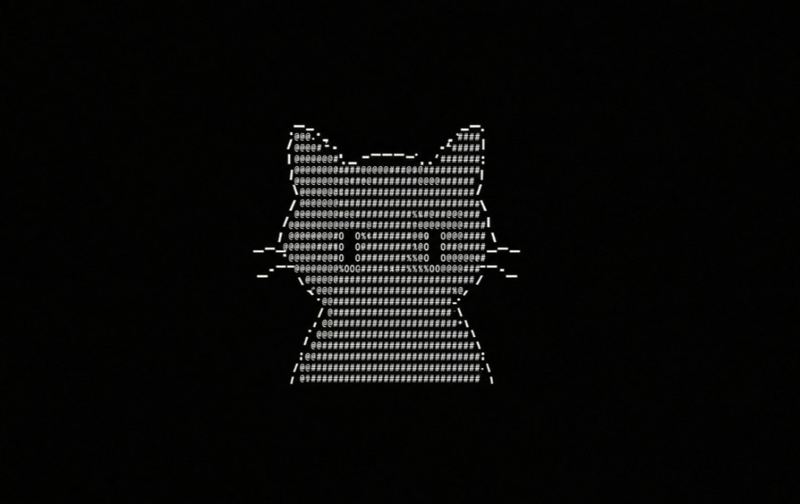
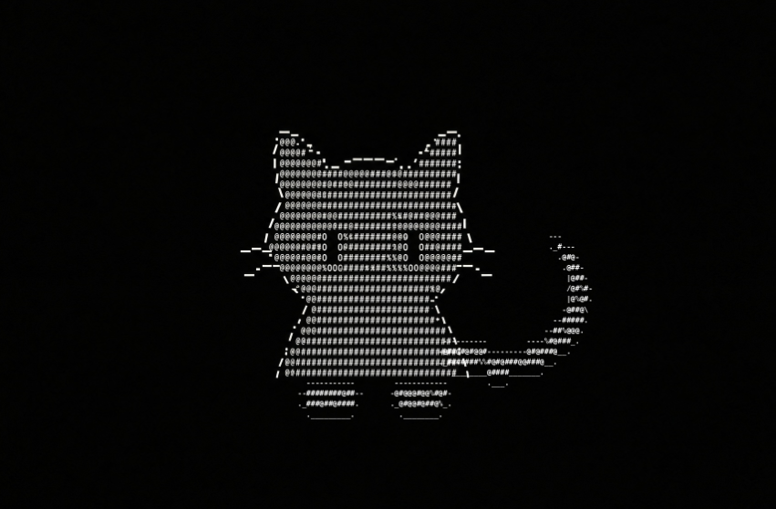
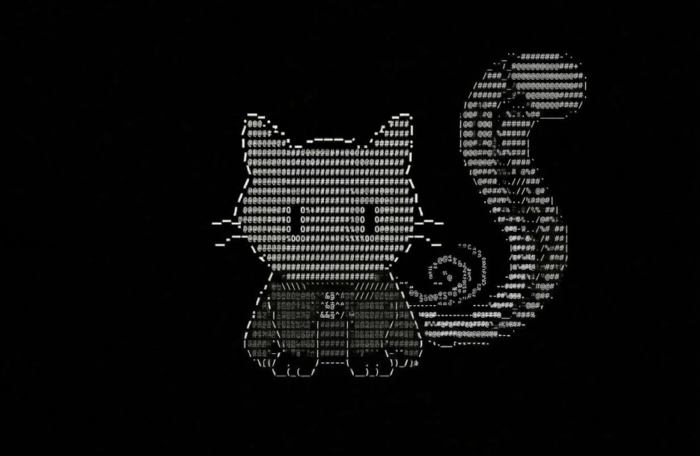
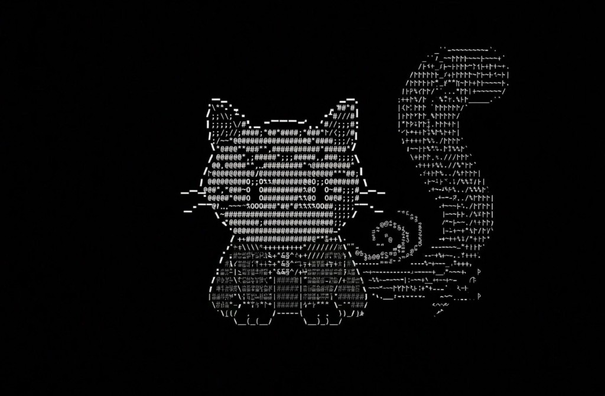
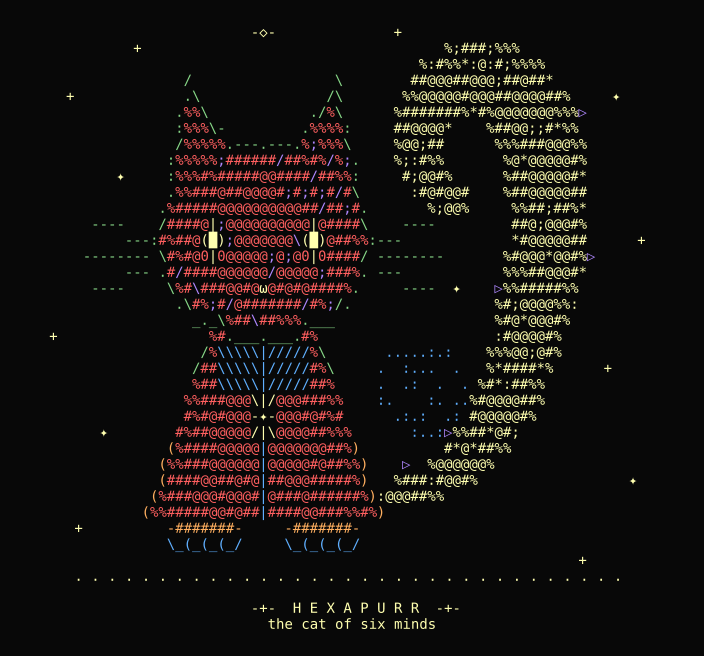

<div align="center">

# HEXAPURR

### *the cat of six minds*

**Six AI models. Six steps. 16.6% each. One cat.**



</div>

---

**HEXAPURR** is a mysterious ASCII-textured cat drawn as a relay. Six AI models took turns, and no single model ever drew the whole thing. Each one received the previous model's image and added roughly **one sixth (16.6%)** of the drawing before passing it on.

OpenAI drew the first lines. Grok, Claude, Gemini and Meta AI each added a layer. NVIDIA closed the circle and gave the cat its eyes, its sparkles and its name.

> **Project status:** An independent, user-orchestrated creative experiment. The participating models belong to OpenAI, xAI (Grok), Anthropic (Claude), Google (Gemini), Meta (Meta AI) and NVIDIA. **None of these companies collaborated on or endorsed HEXAPURR.**

## Run overview

| Property | Value |
| --- | --- |
| Character | **HEXAPURR**, *the cat of six minds* |
| Created | October 2026 |
| Format | Relay drawing, one model per step |
| Steps | 6, about 16.6% of the drawing each |
| Medium | Raster **image** with an ASCII-character texture (not plain text) |
| Palette | Monochrome, off-white glyphs on near-black |
| Relay order | OpenAI → Grok → Claude → Gemini → Meta AI → NVIDIA |
| Step images | [`images/steps/`](images/steps/) |
| Checksums | [`SHA256SUMS.txt`](SHA256SUMS.txt) |

## The starting prompt

Everything began with a single message to OpenAI. It is reproduced here exactly as it was sent, typos included:

> *"Okay i have Something to generate... Lets split it in 6 steps you are OpenAI and you are starting the drawing a mysterious character, simple drawing style, we want drawing in ascii style texsture... generated from 6 different models, and you start her with step 1, i will continue and give step to to different ai, it needs to be an animal, like a cat looking like and start just simple step one, dont finish split steps into 16.6% of drawing... it needs to be image not text!"*

That one message set every rule the relay followed:

| Rule | From the prompt |
| --- | --- |
| **Mysterious character** | *"a mysterious character"* |
| **Simple style** | *"simple drawing style"* |
| **ASCII texture** | *"drawing in ascii style texsture"* |
| **Cat-like animal** | *"it needs to be an animal, like a cat looking like"* |
| **Six models, one step each** | *"split it in 6 steps … generated from 6 different models"* |
| **Never finish** | *"dont finish split steps into 16.6% of drawing"* |
| **Image, not text** | *"it needs to be image not text!"* |

The prompt and a reusable handoff template are in [`PROMPT.md`](PROMPT.md).

## The evolution

<div align="center">

</div>

---

### Step 1: OpenAI, *the outline*

`[█░░░░░] 16.6%`



OpenAI took *"just simple step one"* literally and drew only lines. It made a dashed outline of a cat's head from `_ - . : /` characters, with two pointed ears, two whiskers on each side and two single dots for eyes. Two short lines start to trail down from the jaw, hinting that a body will follow. The inside is completely empty.

**Locked in:** a front-facing cat on a black background, built from characters, with an empty face that leaves room for mystery.

---

### Step 2: Grok, *the fur*

`[██░░░░] 33.3%`



Grok filled the empty outline with dense `@ # %` characters and gave the drawing its texture. The dot eyes became two hollow `0 … 0` rectangles, which give the cat a blank, unreadable stare. The two lines from step 1 became a smooth, bell-shaped body that is also packed with `@` and `#`.

**Locked in:** the "fur language" of dense `@`/`#` characters. Every later model kept it.

---

### Step 3: Claude, *the body*

`[███░░░] 50.0%`



Claude turned the silhouette into a sitting cat. It added two separate paw blocks at the bottom (`-#######-`) and a thin S-shaped tail that rises on the right. The tail is joined to the body by a dashed line. The head from step 2 stayed exactly as it was.

**Locked in:** the seated pose and a tail on the right. That tail was about to become the cat's signature.

---

### Step 4: Gemini, *the tail*

`[████░░] 66.6%`



Gemini made the biggest change to the shape. The thin tail became a **huge curling plume, taller than the cat's head**, shaped like a question mark. A small spiral, drawn in tiny characters, curls at its base. The chest got a striped `\\\\ ////` pattern, the legs were split with `|` dividers, and the paws were drawn in as `\_(_(_/` toes.

**Locked in:** the silhouette. From this step on, HEXAPURR is instantly recognisable by its giant tail.

---

### Step 5: Meta AI, *the glyphs*

`[█████░] 83.3%`



Meta AI kept the shape exactly as it was and changed only the texture. The tail's `@#` fur became **rune-like and box-drawing glyphs** such as `ᚠ ┣ ╋ ~`. Semicolons and slashes crept into the head, and small `▷` marks appeared near the tail. The cat began to look less like an animal and more like an artefact, as if it were written in some old, unknown alphabet.

**Locked in:** the arcane mood. HEXAPURR is not just a cat. Something is *inscribed* in it.

---

### Step 6: NVIDIA, *the soul*

`[██████] 100%`


NVIDIA's last 16.6% brought the character to life:

- **Eyes.** The blank block eyes became **glowing cream-coloured vertical slits**. This is the only colour in the whole drawing.
- **Mouth.** A small `ω`-style cat mouth replaced the empty muzzle.
- **Sigil.** A **starburst mark** sits in the centre of the chest.
- **Stars.** `+` and `✦` sparkles float around the cat, and a compass-star `-◇-` hangs above its head.
- **Ground.** A dotted horizon line puts the cat on the ground.
- **Texture.** Step 4's dense `@#` fur came back, while step 5's arcane touches stayed in the small `* ; :` marks.
- **Name.** The title **`-+- HEXAPURR -+-`** with the line *the cat of six minds*.

**Locked in:** the identity. The character now had a face, a name and a story.

## How we arrived at the character

No model was ever told what the finished cat should look like. Each one saw only the image in front of it and the original rules. HEXAPURR's identity came out of six separate decisions stacked on top of each other:

| Step | Model | Question it answered | Answer that stuck |
| :-: | --- | --- | --- |
| 1 | OpenAI | *What is it?* | A cat, drawn only in outline |
| 2 | Grok | *What is it made of?* | Dense `@ # %` ASCII fur |
| 3 | Claude | *What is it doing?* | Sitting calmly, tail on the right |
| 4 | Gemini | *What makes it unique?* | A giant curled question-mark tail |
| 5 | Meta AI | *What is it, really?* | Something arcane, written in glyphs |
| 6 | NVIDIA | *Who is it?* | **HEXAPURR**, the cat of six minds |

Some details survived the whole relay and some did not:

- **Kept from start to finish:** the whisker shapes and ear lines from step 1, and the head texture from step 2. The cat's face is the oldest part of the drawing.
- **Changed most:** the tail grew from a thin squiggle (step 3) into a plume that dominates the whole picture (step 4).
- **Softened but kept:** step 5's rune glyphs were mostly replaced with `@#` again in step 6, but their mystical feel stayed in the sparkles, the sigil and the compass-star.
- **Never planned:** the name. "Hexa" means six and "purr" is the sound of a cat. Six models each added a mind of their own, so the cat ended up with six.

## Character sheet

| | |
| --- | --- |
| **Name** | HEXAPURR |
| **Title** | The Cat of Six Minds |
| **Species** | Cat-like creature, born from ASCII characters |
| **Pose** | Seated, front-facing, perfectly still |
| **Eyes** | Glowing vertical slits, the only colour in its world |
| **Tail** | Taller than its own head and curled like a question mark, with a spiral at the base |
| **Markings** | Starburst sigil on the chest, striped `\\\\ ////` collar |
| **Texture** | `@ # %` fur with hints of rune-like glyphs |
| **Surroundings** | Darkness, a few drifting stars and a compass-star overhead |
| **Temperament** | Watchful, patient, unreadable |

### The six minds

In HEXAPURR's lore, each part of the cat holds the mind that drew it:

| Mind | Given by | Lives in |
| --- | --- | --- |
| The Mind of **Line** | OpenAI | the ears and whiskers |
| The Mind of **Fur** | Grok | the dense `@#` coat |
| The Mind of **Form** | Claude | the seated body and paws |
| The Mind of **Motion** | Gemini | the great curling tail |
| The Mind of **Glyph** | Meta AI | the runes hidden in its fur |
| The Mind of **Light** | NVIDIA | the glowing eyes and the stars |

## Models used

| Step | Share | Model family | Company |
| :-: | :-: | --- | --- |
| 1 | 16.6% | ChatGPT / GPT image | OpenAI |
| 2 | 16.6% | Grok | xAI |
| 3 | 16.6% | Claude | Anthropic |
| 4 | 16.6% | Gemini | Google |
| 5 | 16.6% | Meta AI | Meta |
| 6 | 16.6% | NVIDIA | NVIDIA |

Exact model versions were not recorded. Each model received the previous step's image together with the relay rules.

## Run the relay yourself

The repository also contains **the HEXAPURR engine**, a zero-dependency Node.js package that replays the relay as six agents, one per mind. Each agent draws only its own part on a shared ASCII canvas, in the original order. After every step the relay checks that nothing earlier was erased and logs a SHA-256 hash of the frame.

<div align="center">


*`hexapurr blame`: every character coloured by the mind that drew it.*
</div>

The agents are deterministic programs named after the models. They do not call any AI API. The images in `images/` come from the real models, and the engine is a reproducible tribute to that run.

Requires Node.js 20 or newer. There is nothing to install.

```bash
node bin/hexapurr.js relay            # replay the six steps one by one
node bin/hexapurr.js draw             # print the finished cat
node bin/hexapurr.js draw --step claude   # stop after step 3
node bin/hexapurr.js blame            # who drew which character
node bin/hexapurr.js ledger           # per-step audit with frame hashes
node bin/hexapurr.js minds            # the six minds and what each gave the cat
node bin/hexapurr.js svg --out cat.svg --blame
node bin/hexapurr.js draw --seed 42   # same shape, different fur
```

Sample `ledger` output:

```text
STEP  MIND    COMPANY    ADDED  RESTYLED  OWNS  SHARE   FRAME SHA-256
1     Line    OpenAI     116    0         114   10.4%   fc18dc28b771674c
2     Fur     xAI        470    0         390   35.7%   d117657851291765
3     Form    Anthropic  81     0         28    2.6%    5332069a573bfec9
4     Motion  Google     339    91        91    8.3%    0f288b389bc22e6e
5     Glyph   Meta       5      365       31    2.8%    c3a6c1f3a731f93b
6     Light   NVIDIA     81     357       438   40.1%   bb9b68a8fccd3fdf
```

Every mind's nominal share is 16.6%. `SHARE` is what each mind still owns in the final frame, after the minds that came later restyled its work. Every frame the engine produces is checked in under [`examples/`](examples/). For the design and the relay rule, see [`docs/ARCHITECTURE.md`](docs/ARCHITECTURE.md).

```bash
npm test              # 37 tests: canvas, geometry, relay rule, renderers, CLI
npm run examples      # regenerate examples/
```

## Verify the images

[`SHA256SUMS.txt`](SHA256SUMS.txt) lists a SHA-256 hash for every image in this repository. To check them:

```bash
# Linux / macOS / Git Bash
sha256sum -c SHA256SUMS.txt
```

```powershell
# Windows PowerShell
Get-Content SHA256SUMS.txt | ForEach-Object {
  $hash, $file = $_ -split '\s+\*?', 2
  $ok = (Get-FileHash $file -Algorithm SHA256).Hash -eq $hash.ToUpper()
  "{0}  {1}" -f ($(if ($ok) { 'OK  ' } else { 'FAIL' })), $file
}
```

These hashes only show that the files have not changed since they were published. They do **not** prove which model produced which image.

To rebuild the evolution banner from the six step images:

```powershell
powershell -ExecutionPolicy Bypass -File tools\make_banner.ps1
```

## Repository structure

```text
Hexapurr/
├── README.md
├── PROMPT.md                         # original starting prompt + relay template
├── SHA256SUMS.txt                    # image checksums
├── package.json
├── images/                           # the original relay, drawn by the real models
│   ├── hexapurr_final.png            # the finished character
│   ├── hexapurr_evolution.png        # all six steps side by side
│   └── steps/
│       ├── step1_openai_outline.png
│       ├── step2_grok_head.png
│       ├── step3_claude_body.png
│       ├── step4_gemini_tail.png
│       ├── step5_metaai_glyphs.png
│       └── step6_nvidia_final.png
├── bin/
│   └── hexapurr.js                   # CLI: draw, relay, blame, ledger, minds, svg
├── src/                              # the HEXAPURR engine
│   ├── index.js
│   ├── canvas.js                     # shared canvas + signed pens
│   ├── anatomy.js                    # the body plan every mind agrees on
│   ├── geometry.js                   # ellipses, polygons, lines, curves, outlines
│   ├── texture.js                    # fur language and runes
│   ├── random.js                     # seeded PRNG
│   ├── relay.js                      # relay order, relay rule, ledger
│   ├── minds/
│   │   ├── mind.js                   # the mind contract
│   │   ├── line.js                   # 1  OpenAI   the outline
│   │   ├── fur.js                    # 2  Grok     the fur
│   │   ├── form.js                   # 3  Claude   the body
│   │   ├── motion.js                 # 4  Gemini   the tail
│   │   ├── glyph.js                  # 5  Meta AI  the glyphs
│   │   └── light.js                  # 6  NVIDIA   the soul
│   └── render/
│       ├── terminal.js               # plain / ANSI / blame output
│       └── svg.js                    # SVG output
├── test/                             # node:test suite
├── examples/                         # generated frames, blame view, ledger
├── scripts/
│   └── build-examples.js             # regenerates examples/
├── docs/
│   └── ARCHITECTURE.md
├── tools/
│   └── make_banner.ps1               # builds hexapurr_evolution.png
└── .github/workflows/ci.yml          # tests on Linux, Windows, macOS
```

---

<div align="center">

```text
 -+-   H E X A P U R R   -+-
      the cat of six minds
```

*HEXAPURR is an independent experiment in multi-model relay drawing, not an official project of any of the AI companies mentioned above.*

</div>
